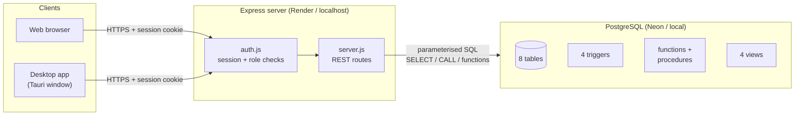
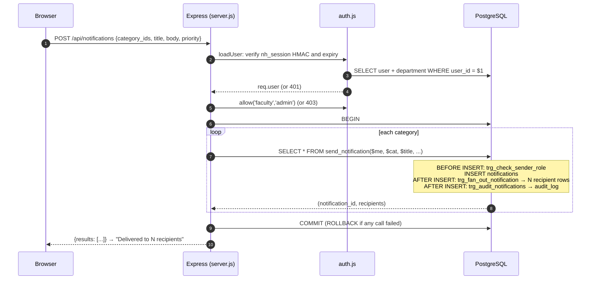
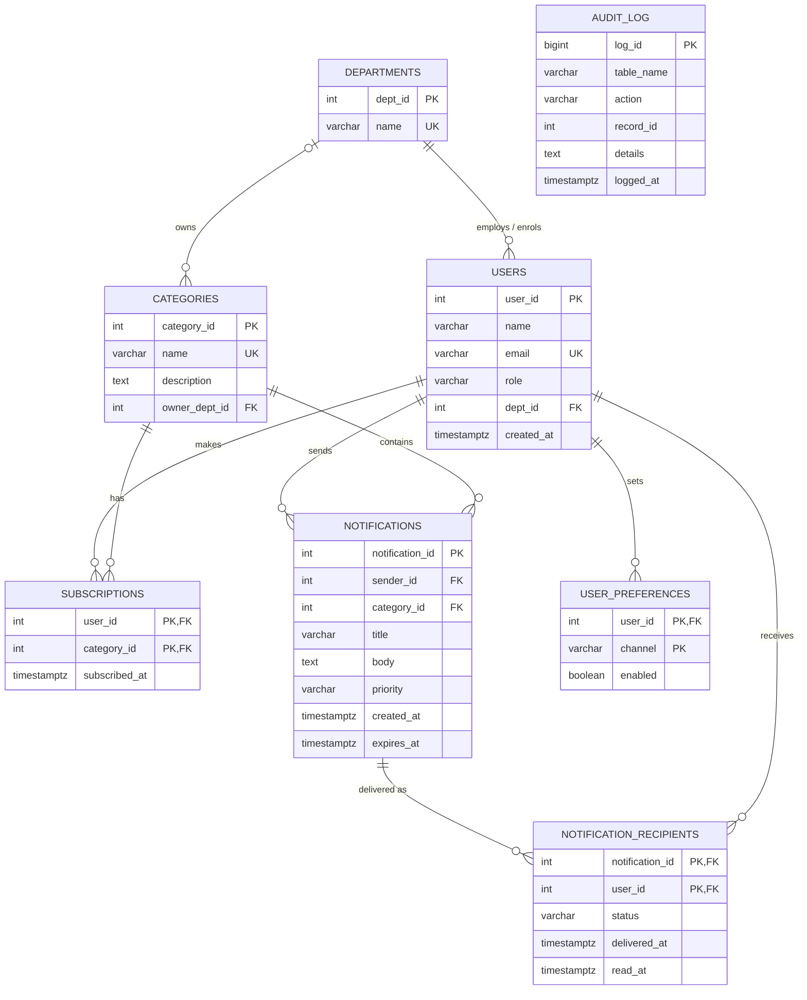
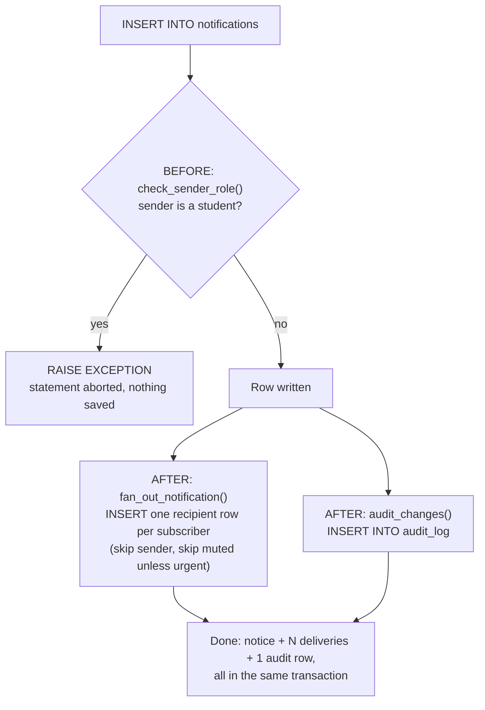
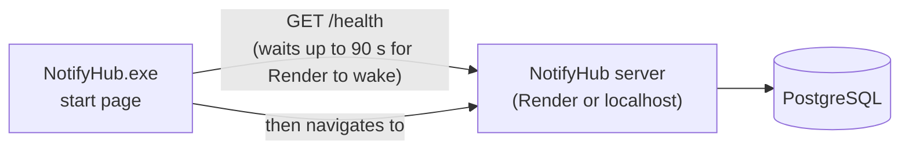

<div align="center">

# NotifyHub

**A campus notification system where the database does the real work.**

Departments, faculty and the admin office post notices to channels. Students subscribe to the
channels they care about and get a personal inbox with read tracking, priorities and expiry.
Fan-out, permission rules, read tracking and auditing all run **inside PostgreSQL**.


</div>

---

## Table of contents

**Overview**
1. [About the project](#1-about-the-project)
2. [Features](#2-features)
3. [Tech stack](#3-tech-stack)
4. [System architecture](#4-system-architecture)
5. [Repository structure](#5-repository-structure)
6. [Getting started](#6-getting-started)

**Database**

7. [Database design](#7-database-design)
   - [7.1 Requirements and business rules](#71-requirements-and-business-rules)
   - [7.2 Conceptual model (ER diagram)](#72-conceptual-model-er-diagram)
   - [7.3 Relational schema](#73-relational-schema)
   - [7.4 Data dictionary](#74-data-dictionary)
   - [7.5 Integrity constraints](#75-integrity-constraints)
   - [7.6 Normalization](#76-normalization)
   - [7.7 Key design decisions](#77-key-design-decisions)
8. [Database programming: triggers, functions, procedures](#8-database-programming-triggers-functions-procedures)
9. [Views and indexes](#9-views-and-indexes)
10. [Transactions and consistency](#10-transactions-and-consistency)
11. [How the database is built](#11-how-the-database-is-built)
12. [Sample data](#12-sample-data)

**Application**

13. [Authentication and authorization](#13-authentication-and-authorization)
14. [Backend and REST API](#14-backend-and-rest-api)
15. [Web frontend](#15-web-frontend)
16. [Desktop app (Tauri)](#16-desktop-app-tauri)
17. [SQL Playground](#17-sql-playground)

**Operations**

18. [Exploring the database (pgAdmin, psql, Neon, Excel)](#18-exploring-the-database)
19. [Deployment (Render + Neon)](#19-deployment-render--neon)
20. [Configuration reference](#20-configuration-reference)
21. [Security model and limitations](#21-security-model-and-limitations)
22. [Testing](#22-testing)

**Reference**

23. [DBMS concepts map and demo queries](#23-dbms-concepts-map-and-demo-queries)
24. [Demo walkthrough](#24-demo-walkthrough)
25. [Design FAQ](#25-design-faq)
26. [Project modules](#26-project-modules)
27. [Troubleshooting](#27-troubleshooting)
28. [Roadmap](#28-roadmap)

---

## 1. About the project

### The problem
Campus notices are scattered across WhatsApp groups, notice boards and email. Students miss
deadlines, nobody knows whether an announcement was read, and anyone in a group can post.

### The solution
NotifyHub puts every notice in one place:
- **Channels (categories)** such as *CSE Department*, *Placements*, *Hostel* and *Exams*.
- **Subscriptions** decide who receives what.
- Each recipient gets their **own delivery record**, which tracks status (unread, read, archived) and when they read it.
- **Analytics** show which channels and departments actually read their notices.

### The design principle
> **The server decides *who* is calling. The database decides *what* is allowed to happen.**

All business rules live in PostgreSQL as constraints, triggers, functions, procedures and views:
- who may post
- who receives a notice
- when `read_at` is set
- what gets audited

The Express server is a thin, authenticated layer that calls them. So the rules hold no matter how
the data is changed: the website, `psql`, pgAdmin or the SQL Playground.

---

## 2. Features

| Area | What it does |
|---|---|
| **Channels and subscriptions** | Users subscribe to and unsubscribe from categories. Every student is automatically subscribed to their department's channel and *Exams* |
| **Fan-out on write** | Posting one notice creates one delivery row per subscriber. A trigger does this, not the app |
| **Priorities** | `low`, `normal`, `high`, `urgent`. Urgent notices reach users even if they've muted in-app notifications |
| **Read tracking** | `read_at` is set automatically when a delivery becomes `read`, and cleared if it goes back to `unread` |
| **Expiry and archiving** | Notices can expire. The inbox view hides expired notices, and a stored procedure archives their deliveries |
| **Multi-channel send** | One notice to several channels runs as one transaction. If any channel fails, nothing is sent |
| **Roles** | **Student:** inbox only. **Faculty:** inbox and compose. **Admin:** everything. Enforced by the server *and* the database |
| **Sign in / sign up** | Signed session cookies, a login rate limit, and student self sign-up with an access code |
| **Analytics** | Read rates and time-to-read by channel, department, sender and priority. All computed by SQL views |
| **Audit log** | One generic trigger function records inserts, updates and deletes on key tables as JSON |
| **SQL Playground** | Admins run live SQL against the database. Read-only by default, one statement at a time, with a 5 s timeout |
| **UI** | Light (parchment) and dark themes, a responsive layout and a mobile tab bar |
| **Desktop app** | A native Windows app built with Tauri 2 |
| **Free hosting** | Render runs the app and Neon hosts Postgres. The database builds itself on first start |

---

## 3. Tech stack

| Layer | Technology | Why |
|---|---|---|
| Database | **PostgreSQL 14+** (local, or Neon serverless Postgres) | Triggers, PL/pgSQL, procedures, partial indexes, window functions, JSONB |
| Server | **Node.js 18+**, **Express 4**, **node-postgres (`pg`) 8** | Small, readable API layer with a connection pool |
| Auth | Node's built-in `crypto` (HMAC-SHA256, `timingSafeEqual`) | No extra dependencies. Signed, tamper-proof sessions |
| Web UI | One static `public/index.html`: HTML, CSS and vanilla JavaScript | No build step and no framework, so the focus stays on the database |
| Desktop | **Tauri 2** (Rust + WebView2) | A native window that is ~5 MB, instead of ~150 MB for Electron |
| Hosting | **Render** (web service) and **Neon** (database) | Both have free tiers and deploy from GitHub |
| Fonts | Newsreader, IBM Plex Sans, IBM Plex Mono | |

Runtime dependencies: just `express` and `pg`.

---

## 4. System architecture



| Layer | Responsible for | Not responsible for |
|---|---|---|
| **Client** (browser or desktop) | Showing pages, sending forms, hiding menu items the role can't use | Security. Hidden menus are only cosmetic |
| **Server** | **Who** is calling (session cookie), **which role** may use a route, transactions, input validation | Business rules. It never decides who receives a notice |
| **Database** | **What** happens to data: integrity, fan-out, sender rule, read time, auditing, analytics | Knowing about HTTP or sessions |

### Request lifecycle: a faculty member sends a notice



---

## 5. Repository structure

```
notifyhub/
├── db/
│   ├── 00_reset.sql            Drops every NotifyHub object (works on Neon, where the schema can't be dropped)
│   ├── 01_schema.sql           8 tables with PK / FK / UNIQUE / NOT NULL / CHECK constraints
│   ├── 02_logic.sql            4 trigger functions (6 triggers), 2 functions, 2 stored procedures
│   ├── 03_views_indexes.sql    4 views, 4 indexes (one of them partial)
│   ├── 04_seed.sql             Deterministic sample data: 200 users, 30 notices, ~3,000 deliveries
│   └── 05_demo_queries.sql     16 showcase queries (run by hand, never automatically)
├── public/
│   └── index.html              The whole web UI: sign-in, Inbox, Compose, Analytics, SQL Playground, Audit Log
├── desktop/                    Tauri 2 desktop app (see section 16)
│   ├── src/                    Start page and server picker bundled into the app
│   ├── src-tauri/              Rust entry point, Tauri config, icons
│   └── app-icon.svg            Source for every icon size
├── server.js                   Express app: routes, transactions, auto-build on first start
├── auth.js                     Sessions (HMAC cookies), role checks, login rate limit
├── config.js                   DB connection: DATABASE_URL (Neon) or local PG* variables
├── db-setup.js                 Runs 00 → 04 in order. Shared by server.js and setup.js
├── setup.js                    `npm run setup`: create the DB if missing, then wipe and rebuild it
├── export-data.js              Dumps every table and view to notifyhub-data.json
├── NotifyHub-Database.xlsx     Snapshot of every table and view (one sheet each)
└── package.json                `npm start`, `npm run setup`
```

---

## 6. Getting started

### Prerequisites
- **Node.js 18+**
- **One** of these:
  - **PostgreSQL 14+** installed locally (the Windows installer includes pgAdmin 4)
  - A free **Neon** database (nothing to install)

### Option A: local PostgreSQL
```powershell
npm install
$env:PGPASSWORD="your-postgres-password"   # set it in the shell; never write it into config.js
npm run setup                               # creates database "notifyhub" if needed and builds everything
npm start
```

### Option B: Neon
```powershell
npm install
$env:DATABASE_URL="postgresql://<user>:<password>@<host>.neon.tech/neondb?sslmode=require"
npm start                                   # an empty database is built automatically on first start
```

Open **http://localhost:3000** and sign in with a [demo account](#demo-accounts).

### Useful commands
| Command | What it does |
|---|---|
| `npm start` | Starts the server. Builds the database only if it's empty |
| `npm run setup` | **Wipes and rebuilds** the database with fresh sample data |
| `node export-data.js` | Exports every table and view to `notifyhub-data.json` |
| `psql -U postgres -d notifyhub -f db/05_demo_queries.sql` | Runs all 16 demo queries |

---

## 7. Database design

### 7.1 Requirements and business rules

**Entities identified from the requirements:** departments, users, categories (channels),
subscriptions, notifications, deliveries (recipients), notification preferences, and an audit trail.

| # | Business rule | Enforced by |
|---|---|---|
| BR1 | Every user has exactly one role: student, faculty or admin | `CHECK (role IN (...))` |
| BR2 | Email addresses are unique | `UNIQUE (email)` |
| BR3 | **Only faculty and admins can send notices** | Trigger `trg_check_sender_role` (and the server's role check) |
| BR4 | A notice belongs to exactly one category and has exactly one sender | `NOT NULL` foreign keys |
| BR5 | **A notice is delivered to every subscriber of its category, except the sender** | Trigger `trg_fan_out_notification` |
| BR6 | Users who muted in-app notifications don't receive notices, **unless the notice is urgent** | Same trigger, `NOT EXISTS` on `user_preferences` |
| BR7 | Each recipient has their own status: unread, read or archived | `notification_recipients.status` + `CHECK` |
| BR8 | `read_at` is set when a delivery is read and cleared when it's marked unread | Trigger `trg_sync_read_at` |
| BR9 | A notice can't expire before it was created; it can't be read before it was delivered | Table-level `CHECK`s |
| BR10 | Expired notices disappear from inboxes and can be archived | View `user_inbox`, procedure `archive_expired()` |
| BR11 | Deleting a user who has posted notices is not allowed | `ON DELETE RESTRICT` on `sender_id` |
| BR12 | Changes to users, notices and subscriptions are audited, and the history outlives the rows | Trigger `audit_changes()`; `audit_log` has no FKs |
| BR13 | A user can subscribe to a category only once and receives a notice only once | Composite primary keys |

### 7.2 Conceptual model (ER diagram)



#### Relationships and cardinality

| Relationship | Type | Implemented as | Participation |
|---|---|---|---|
| Department → Users | 1 : N | `users.dept_id` FK | Optional for users (the admin has no department) |
| Department → Categories | 1 : N | `categories.owner_dept_id` FK | Optional (*Exams* and *Sports* are campus-wide) |
| Users ↔ Categories (*subscribes*) | **M : N** | Associative entity `subscriptions` | Optional on both sides |
| User → Notifications (*sends*) | 1 : N | `notifications.sender_id` FK | Mandatory for notifications |
| Category → Notifications | 1 : N | `notifications.category_id` FK | Mandatory for notifications |
| Notifications ↔ Users (*receives*) | **M : N** | Associative entity `notification_recipients`, with its own attributes (`status`, `read_at`) | Optional |
| User → Preferences | 1 : N (at most 3) | `user_preferences` with composite key (`user_id`, `channel`) | Optional |
| Audit log | Standalone | No FKs, on purpose (see 7.7) | n/a |

`notification_recipients` is the **core table**. The relationship between a notice and a
recipient has attributes of its own (status and read time), so it has to be its own table.

### 7.3 Relational schema

Underlined = primary key, *italic* = foreign key.

- **departments** (<u>dept_id</u>, name)
- **users** (<u>user_id</u>, name, email, role, *dept_id* → departments, created_at)
- **categories** (<u>category_id</u>, name, description, *owner_dept_id* → departments)
- **subscriptions** (<u>*user_id*</u> → users, <u>*category_id*</u> → categories, subscribed_at)
- **notifications** (<u>notification_id</u>, *sender_id* → users, *category_id* → categories, title, body, priority, created_at, expires_at)
- **notification_recipients** (<u>*notification_id*</u> → notifications, <u>*user_id*</u> → users, status, delivered_at, read_at)
- **user_preferences** (<u>*user_id*</u> → users, <u>channel</u>, enabled)
- **audit_log** (<u>log_id</u>, table_name, action, record_id, details, logged_at)

### 7.4 Data dictionary

#### `departments`
| Column | Type | Null | Default | Constraints | Description |
|---|---|---|---|---|---|
| dept_id | SERIAL | No | sequence | **PK** | Department id |
| name | VARCHAR(100) | No | | UNIQUE | e.g. *Computer Science* |

#### `users`
| Column | Type | Null | Default | Constraints | Description |
|---|---|---|---|---|---|
| user_id | SERIAL | No | sequence | **PK** | User id |
| name | VARCHAR(100) | No | | | Display name |
| email | VARCHAR(150) | No | | UNIQUE | Sign-in identifier |
| role | VARCHAR(20) | No | | CHECK ∈ {student, faculty, admin} | Decides permissions |
| dept_id | INT | Yes | | **FK** → departments, ON DELETE SET NULL | Home department (NULL for the admin) |
| created_at | TIMESTAMPTZ | No | `now()` | | When the account was created |

#### `categories`
| Column | Type | Null | Default | Constraints | Description |
|---|---|---|---|---|---|
| category_id | SERIAL | No | sequence | **PK** | Channel id |
| name | VARCHAR(100) | No | | UNIQUE | e.g. *Placements* |
| description | TEXT | Yes | | | Shown in the UI |
| owner_dept_id | INT | Yes | | **FK** → departments, ON DELETE SET NULL | Owning department. NULL = campus-wide |

#### `subscriptions`
| Column | Type | Null | Default | Constraints | Description |
|---|---|---|---|---|---|
| user_id | INT | No | | **PK**, **FK** → users, CASCADE | Subscriber |
| category_id | INT | No | | **PK**, **FK** → categories, CASCADE | Channel |
| subscribed_at | TIMESTAMPTZ | No | `now()` | | When they subscribed |

#### `notifications`
| Column | Type | Null | Default | Constraints | Description |
|---|---|---|---|---|---|
| notification_id | SERIAL | No | sequence | **PK** | Notice id |
| sender_id | INT | No | | **FK** → users, **ON DELETE RESTRICT** | Who posted it (must be faculty or admin, checked by trigger) |
| category_id | INT | No | | **FK** → categories, CASCADE | Channel it was posted to |
| title | VARCHAR(200) | No | | | Headline |
| body | TEXT | No | | | Message |
| priority | VARCHAR(10) | No | `'normal'` | CHECK ∈ {low, normal, high, urgent} | Urgent bypasses mute |
| created_at | TIMESTAMPTZ | No | `now()` | | Posted at |
| expires_at | TIMESTAMPTZ | Yes | | CHECK `expires_at > created_at` | Optional expiry |

#### `notification_recipients`
| Column | Type | Null | Default | Constraints | Description |
|---|---|---|---|---|---|
| notification_id | INT | No | | **PK**, **FK** → notifications, CASCADE | The notice |
| user_id | INT | No | | **PK**, **FK** → users, CASCADE | The recipient |
| status | VARCHAR(10) | No | `'unread'` | CHECK ∈ {unread, read, archived} | Delivery state |
| delivered_at | TIMESTAMPTZ | No | `now()` | | Set to the notice's `created_at` by the fan-out trigger |
| read_at | TIMESTAMPTZ | Yes | | CHECK `read_at >= delivered_at` | Maintained by `trg_sync_read_at` |

#### `user_preferences`
| Column | Type | Null | Default | Constraints | Description |
|---|---|---|---|---|---|
| user_id | INT | No | | **PK**, **FK** → users, CASCADE | Owner |
| channel | VARCHAR(10) | No | | **PK**, CHECK ∈ {in_app, email, sms} | Delivery channel |
| enabled | BOOLEAN | No | `TRUE` | | `in_app = FALSE` means muted |

#### `audit_log`
| Column | Type | Null | Default | Constraints | Description |
|---|---|---|---|---|---|
| log_id | BIGSERIAL | No | sequence | **PK** | Entry id (BIGINT, since this table grows fastest) |
| table_name | VARCHAR(50) | No | | | Table that changed (`TG_TABLE_NAME`) |
| action | VARCHAR(10) | No | | | INSERT / UPDATE / DELETE (`TG_OP`) |
| record_id | INT | Yes | | | Id of the changed row (column named by `TG_ARGV[0]`) |
| details | TEXT | Yes | | | The whole row as JSON (`to_jsonb(NEW/OLD)`) |
| logged_at | TIMESTAMPTZ | No | `now()` | | When it happened |

### 7.5 Integrity constraints

| Kind | Where | Examples |
|---|---|---|
| **Entity integrity** | Every table has a PK | Surrogate keys (`SERIAL`) for entities; composite keys for associative tables |
| **Domain integrity** | `NOT NULL`, `CHECK`, types | `role`, `priority`, `status`, `channel` enumerations |
| **Key constraints** | `UNIQUE` | `users.email`, `departments.name`, `categories.name` |
| **Referential integrity** | Foreign keys with chosen actions | See the table below |
| **Semantic (multi-column)** | Table-level `CHECK` | `expires_at > created_at`, `read_at >= delivered_at` |
| **Business rules** | Triggers | Only staff can send; fan-out; `read_at` sync |

#### Referential actions and why each was chosen

| Foreign key | ON DELETE | Reason |
|---|---|---|
| `users.dept_id` | **SET NULL** | Closing a department shouldn't delete its people |
| `categories.owner_dept_id` | **SET NULL** | The channel survives and becomes campus-wide |
| `subscriptions.*` | **CASCADE** | A subscription means nothing without its user or category |
| `notifications.sender_id` | **RESTRICT** | Deleting a staff member must not silently erase everything they posted |
| `notifications.category_id` | **CASCADE** | Deleting a channel removes its notices |
| `notification_recipients.*` | **CASCADE** | Deliveries depend on both the notice and the user |
| `user_preferences.user_id` | **CASCADE** | Preferences belong to the user |

### 7.6 Normalization

Every table is in **Boyce–Codd Normal Form**: for every non-trivial functional dependency X → Y,
X is a superkey.

| Table | Functional dependencies | Candidate keys | Highest NF |
|---|---|---|---|
| departments | dept_id → name; name → dept_id | {dept_id}, {name} | BCNF |
| users | user_id → name, email, role, dept_id, created_at; email → user_id | {user_id}, {email} | BCNF |
| categories | category_id → name, description, owner_dept_id; name → category_id | {category_id}, {name} | BCNF |
| subscriptions | (user_id, category_id) → subscribed_at | {user_id, category_id} | BCNF |
| notifications | notification_id → all other columns | {notification_id} | BCNF |
| notification_recipients | (notification_id, user_id) → status, delivered_at, read_at | {notification_id, user_id} | BCNF |
| user_preferences | (user_id, channel) → enabled | {user_id, channel} | BCNF |
| audit_log | log_id → all other columns | {log_id} | BCNF |

**How the design got there, from an unnormalized starting point:**

1. **UNF → 1NF.** A naive `notices(title, body, sender_name, sender_dept, category, recipients[], read_by[])`
   has repeating groups. Recipients and read status become **one row per (notice, recipient)**, which
   gives `notification_recipients`.
2. **1NF → 2NF.** In that combined row, `title`, `body` and `sender` depend only on `notification_id`,
   which is part of the key (a partial dependency). They move to `notifications`, leaving only
   per-recipient facts (`status`, `read_at`) keyed by the full pair.
3. **2NF → 3NF.** `sender_id → sender_dept → dept_name` is a transitive dependency. The department
   becomes its own table, referenced by id from `users` and `categories`.
4. **3NF → BCNF.** The only other determinants are `email` and the unique `name` columns, which are
   candidate keys, so no further decomposition is needed.

Deliberate exceptions:
- `audit_log.details` stores a JSON snapshot. It's a historical record, not live data, so it is
  meant to be redundant: it describes rows that may no longer exist.
- The analytics are **views**, so counts like "subscribers" are computed on demand rather than stored.

### 7.7 Key design decisions

| Decision | Alternatives considered | Why this one |
|---|---|---|
| **Fan-out on write** (store one delivery row per recipient) | Work out recipients from subscriptions when an inbox is read | Each recipient needs their own status and read time. Inbox reads are far more frequent than sends. Someone who subscribes today shouldn't receive last month's notices |
| **Rules in triggers**, not app code | Validate in Express | Rules hold for every client, including `psql`, and can't be skipped |
| **Surrogate keys** (`SERIAL`) for entities | Natural keys (email, name) | Emails and names can change; integer FKs are small and fast |
| **Composite PKs** for `subscriptions` and `notification_recipients` | A surrogate id plus a UNIQUE constraint | The pair *is* the identity, and duplicates become impossible |
| **CHECK constraints** for enumerations | Lookup tables or `ENUM` types | Small fixed sets; easy to read and change in a demo |
| **`TIMESTAMPTZ`** everywhere | `TIMESTAMP` | Unambiguous across time zones (Neon runs in UTC) |
| **`audit_log` without FKs** | FKs to each table | History must survive deleting the rows it describes, and one log covers several tables |
| **One generic audit function** with `TG_ARGV` | One function per table | Less code: the same function is reused on three tables |
| **Partial index** for unread rows | Index all rows | Unread is a small, hot subset, so the index stays tiny |

---

## 8. Database programming: triggers, functions, procedures

All of this is in [`db/02_logic.sql`](db/02_logic.sql).

### Triggers

| Trigger | Timing / event | Function | Behaviour |
|---|---|---|---|
| `trg_check_sender_role` | BEFORE INSERT on `notifications` | `check_sender_role()` | Looks up the sender's role. `RAISE EXCEPTION` if the sender doesn't exist or is a student, which aborts the insert |
| `trg_fan_out_notification` | AFTER INSERT on `notifications` | `fan_out_notification()` | `INSERT … SELECT` one `notification_recipients` row per subscriber, skipping the sender and muted users. Urgent notices ignore the mute |
| `trg_sync_read_at` | BEFORE UPDATE OF `status` on `notification_recipients` | `sync_read_at()` | `→ read` sets `read_at = COALESCE(read_at, now())`; `→ unread` sets `read_at = NULL` |
| `trg_audit_notifications` | AFTER INSERT/DELETE on `notifications` | `audit_changes('notification_id')` | Writes the row as JSON to `audit_log` |
| `trg_audit_users` | AFTER INSERT/UPDATE/DELETE on `users` | `audit_changes('user_id')` | Same |
| `trg_audit_subscriptions` | AFTER INSERT/DELETE on `subscriptions` | `audit_changes('user_id')` | Same |

**What one `INSERT INTO notifications` sets off:**



The fan-out query (simplified):

```sql
INSERT INTO notification_recipients (notification_id, user_id, delivered_at)
SELECT NEW.notification_id, s.user_id, NEW.created_at
FROM subscriptions s
WHERE s.category_id = NEW.category_id
  AND s.user_id <> NEW.sender_id
  AND (NEW.priority = 'urgent'
       OR NOT EXISTS (SELECT 1 FROM user_preferences p
                      WHERE p.user_id = s.user_id AND p.channel = 'in_app' AND p.enabled = FALSE));
```

### Functions

| Function | Returns | Purpose |
|---|---|---|
| `send_notification(sender, category, title, body, priority = 'normal', expires_at = NULL)` | `TABLE(notification_id INT, recipients INT)` | One call to post a notice. The insert runs the triggers, then the function counts the deliveries created |
| `unread_count(user_id)` | `INT` | Unread, non-expired deliveries. Written in SQL and marked `STABLE`, so the planner can optimise it inside queries |

### Stored procedures

| Procedure | Purpose |
|---|---|
| `CALL mark_all_read(user_id)` | `UPDATE … SET status = 'read'` for every unread delivery. `trg_sync_read_at` fills in `read_at` |
| `CALL archive_expired()` | Archives every delivery of an expired notice (`UPDATE … FROM notifications`) |

**Function vs procedure:** a function returns a value and can be used inside `SELECT`. A
procedure is run with `CALL`, returns nothing and may control transactions.

---

## 9. Views and indexes

All of this is in [`db/03_views_indexes.sql`](db/03_views_indexes.sql).

### Views

| View | Built from | Columns | Used by |
|---|---|---|---|
| `user_inbox` | recipients ⋈ notifications ⋈ categories ⋈ users (sender) | user_id, notification_id, title, body, priority, category, sender, status, delivered_at, read_at, expires_at. **Hides archived and expired notices** | Inbox |
| `category_stats` | categories ⟕ notifications ⟕ recipients | subscribers, notifications_sent, deliveries, reads, read_rate_pct, avg_hours_to_read | Analytics |
| `dept_engagement` | departments ⋈ users ⟕ recipients | users, deliveries, reads, read_rate_pct | Analytics |
| `sender_stats` | users ⋈ notifications ⟕ recipients | posted, reached, read_rate_pct | Analytics |

The views use `LEFT JOIN` so that zero rows still show up (e.g. a channel that has never posted),
and `NULLIF(…, 0)` so dividing by zero gives NULL instead of an error.

### Indexes

| Index | Definition | Serves |
|---|---|---|
| `idx_nr_user_status` | `notification_recipients (user_id, status)` | Inbox: "user X's rows with status Y" |
| `idx_nr_unread` | `notification_recipients (user_id) WHERE status = 'unread'` | **Partial index.** Only unread rows, so it's small and makes unread counts fast |
| `idx_subs_category` | `subscriptions (category_id)` | The fan-out trigger finds subscribers by category. The PK `(user_id, category_id)` can't serve that, because the category isn't its first column |
| `idx_notif_category_created` | `notifications (category_id, created_at DESC)` | Latest notices per category |

Primary keys and `UNIQUE` constraints create their own B-tree indexes as well. Demo query Q14 runs
`EXPLAIN ANALYZE` to show the partial index being used.

---

## 10. Transactions and consistency

| Scenario | Guarantee |
|---|---|
| **One send** | The notice, its fan-out rows and its audit row come from one statement in one transaction. **Atomic:** all or nothing |
| **Send to several channels** | `server.js` runs `BEGIN`, calls `send_notification()` once per channel, then `COMMIT`. Any error leads to `ROLLBACK`, so no channel receives a partial send |
| **Student sign-up** | Creating the user and adding their default subscriptions is one transaction. A duplicate email (`23505`) leaves nothing behind |
| **Trigger errors** | `RAISE EXCEPTION` aborts the whole statement, which is how the database rejects a student sender |
| **SQL Playground** | Each query runs in `BEGIN READ ONLY … ROLLBACK` unless writes are enabled, with `SET LOCAL statement_timeout = '5s'` |
| **Savepoints** | Demo query Q15 shows `SAVEPOINT` / `ROLLBACK TO` |

Concurrency relies on PostgreSQL's default **READ COMMITTED** isolation plus row-level locks. Two
sends at the same moment each insert their own rows, and the composite PKs make duplicate
deliveries impossible.

---

## 11. How the database is built

`db-setup.js` runs these files in order:

| # | File | Creates |
|---|---|---|
| 1 | `00_reset.sql` | Drops every NotifyHub object if it exists (safe on Neon) |
| 2 | `01_schema.sql` | 8 tables and their constraints |
| 3 | `02_logic.sql` | Trigger functions, triggers, functions, procedures |
| 4 | `03_views_indexes.sql` | Indexes and views |
| 5 | `04_seed.sql` | Sample data. The triggers create the deliveries |

When it runs:
- **`npm run setup`:** always (a full wipe). It first creates the `notifyhub` database locally if it's missing.
- **`npm start`:** only when `to_regclass('public.notification_recipients') IS NULL`, i.e. the database
  is empty. Redeploys never wipe data. If the database can't be reached, the server exits, so Render
  marks the deploy as failed instead of serving a broken app.

---

## 12. Sample data

`db/04_seed.sql` is **deterministic** (`setseed(0.42)`):

| Data | Amount |
|---|---|
| Departments | 5: Computer Science, Electronics, Mechanical, Training & Placement, Hostel Office |
| Users | 200: 1 admin, 5 faculty, 14 named students, 180 generated students (`student21@` … `student200@college.edu`) |
| Categories | 8: CSE / ECE / ME Department, Placements, Hostel, Exams, Coding Club, Sports |
| Subscriptions | ~770. Every student follows their own department and *Exams*. Optional channels at random: Placements ~75%, Hostel ~55%, Coding Club ~35%, Sports ~30% |
| Preferences | 400 rows. ~6% of generated students muted in-app; ~60% have email on |
| Notices | 30 over the last month. One is already expired, so it gets archived |
| Deliveries | ~3,000, created by the fan-out trigger |
| Read behaviour | Urgent ~95% read within 6 h, high ~80% within 24 h, normal ~60% within 48 h, low ~35% within 96 h |
| "Ghost" students | Users 193–200 never read anything, for the anti-join demo (Q9) |
| Audit log | Starts empty (`TRUNCATE … RESTART IDENTITY`), so a demo only shows its own actions |

### Named users

| ID | Name | Role | Department | Email |
|---|---|---|---|---|
| 1 | Admin Office | admin | — | admin@college.edu |
| 2 | Dr. Meera Iyer | faculty | Computer Science | meera.iyer@college.edu |
| 3 | Dr. Rajesh Kumar | faculty | Electronics | rajesh.kumar@college.edu |
| 4 | Prof. Anil Verma | faculty | Mechanical | anil.verma@college.edu |
| 5 | Neha Kapoor (TPO) | faculty | Training & Placement | tpo@college.edu |
| 6 | Suresh Patil | faculty | Hostel Office | warden@college.edu |
| 7 | **Siddharth Paul** | student | Computer Science | siddharth@college.edu |
| 8 | **Anshika Pandey** | student | Computer Science | anshika@college.edu |
| 9 | **Bhavesh** | student | Computer Science | bhavesh@college.edu |
| 10 | **Dhwanit Vyas** | student | Computer Science | dhwanit@college.edu |
| 11 | **Kunal** | student | Electronics | kunal@college.edu |
| 12–20 | Rohan, Priya, Vikram, Sneha, Arjun, Diya, Ananya, Pooja, Harsh | student | various | `<firstname>@college.edu` |

---

## 13. Authentication and authorization

Accounts are the **existing rows in `users`**; the schema wasn't changed for sign-in. For a
simple demo, **every account with the same role shares one password**, set by environment variables.

### Demo accounts

| Role | Email | Password |
|---|---|---|
| Admin | `admin@college.edu` | `admin123` |
| Faculty | `meera.iyer@`, `rajesh.kumar@`, `anil.verma@`, `tpo@`, `warden@college.edu` | `faculty123` |
| Student | `siddharth@`, `anshika@`, `bhavesh@`, `dhwanit@`, `kunal@college.edu`, … `student21@` – `student200@college.edu` | `student123` |

> These are the defaults. Set `ADMIN_PASSWORD`, `FACULTY_PASSWORD` and `STUDENT_PASSWORD` on any
> public deployment.

### Permissions

| | Inbox | Compose | Analytics | SQL Playground | Audit Log |
|---|:-:|:-:|:-:|:-:|:-:|
| **Student** | ✔ own | — | — | — | — |
| **Faculty** | ✔ own | ✔ as self | — | — | — |
| **Admin** | ✔ own | ✔ as self | ✔ | ✔ | ✔ |

### How it works (`auth.js`)

1. **Login** (`POST /api/auth/login`) finds the email (case-insensitive) and compares the password
   to that role's password using SHA-256 plus `crypto.timingSafeEqual`, which takes the same time
   whether or not the password is right. An unknown email and a wrong password give the same error,
   so the form can't be used to find out which emails exist.
2. **Session cookie** `nh_session` = `base64url({uid, exp})` + `.` + `HMAC-SHA256(payload, SESSION_SECRET)`.
   Its flags: `HttpOnly`, `SameSite=Lax`, `Secure` over HTTPS, and a 12 h lifetime. Changing the
   payload breaks the signature.
3. **Every `/api` request** after the public routes goes through `loadUser`. It verifies the
   signature and expiry, then reloads the user from the database, so a role change applies
   immediately. Otherwise it returns **401**.
4. **Role guard** `allow('faculty','admin')` returns **403** for anyone else.
5. **Identity always comes from the session:** routes are `/api/me/...`, and Compose ignores any
   `sender_id` in the request body.
6. **Brute-force limit:** 10 failed logins per IP in 15 minutes leads to **429**.
7. **Sign-up (students only):** name, email, department and the access code (= the student password).
   In one transaction it inserts the user (audited) and subscribes them to their department channel and *Exams*.

**Two layers stop a student posting:** the server's 403, and the database trigger.

---

## 14. Backend and REST API

### Startup
`config.js` (DATABASE_URL or PG\*) → `pg.Pool` (idle timeout 10 s, connect timeout 15 s, plus an
`error` handler so Neon closing idle connections doesn't crash the process) → auto-build if the
database is empty → `app.listen(PORT)`.

### Error format
Errors are returned as `{ "error": "message" }`.

| Code | Meaning |
|---|---|
| 400 | Bad input, or the database refused it (a trigger's message is passed through) |
| 401 | Not signed in / session expired / wrong credentials |
| 403 | The role isn't allowed to use this route |
| 404 | Unknown API route |
| 429 | Too many failed sign-ins |

### Public routes
| Method | Path | Body | Returns |
|---|---|---|---|
| GET | `/health` | — | `ok`. Doesn't touch the database |
| POST | `/api/auth/login` | `{ email, password }` | The user plus `views`, and sets the cookie |
| GET | `/api/auth/departments` | — | Departments available at sign-up |
| POST | `/api/auth/signup` | `{ name, email, dept_id, code }` | The new student, signed in |
| POST | `/api/auth/logout` | — | `{ ok: true }`, and clears the cookie |

### Signed-in routes
| Method | Path | Roles | Body | Database objects used |
|---|---|---|---|---|
| GET | `/api/auth/me` | all | — | `users` ⟕ `departments` |
| GET | `/api/categories` | all | — | `categories` + subscriber count |
| GET | `/api/me/inbox` | all | — | view `user_inbox`, function `unread_count()` |
| POST | `/api/me/read/:nid` | all | — | `UPDATE notification_recipients` → `trg_sync_read_at` |
| POST | `/api/me/read-all` | all | — | `CALL mark_all_read()` |
| GET | `/api/me/settings` | all | — | `subscriptions`, `user_preferences` |
| PUT | `/api/me/subscriptions/:cid` | all | `{ subscribed }` | INSERT … ON CONFLICT DO NOTHING / DELETE → audit trigger |
| PUT | `/api/me/in-app` | all | `{ enabled }` | Upsert into `user_preferences` |
| POST | `/api/notifications` | faculty, admin | `{ category_ids[], title, body, priority?, expires_at? }` | `send_notification()` per category in **one transaction** |
| GET | `/api/users` | admin | — | `users` ⟕ `departments` |
| GET | `/api/stats` | admin | — | `category_stats`, `dept_engagement`, `sender_stats`, plus aggregates |
| GET | `/api/audit` | admin | — | Latest 100 `audit_log` rows |
| POST | `/api/query` | admin | `{ sql, allowWrites? }` | SQL Playground |

Every query uses placeholders (`$1, $2…`), so form input can't cause SQL injection.

```bash
curl -c jar.txt -X POST http://localhost:3000/api/auth/login -H "Content-Type: application/json" \
  -d '{"email":"meera.iyer@college.edu","password":"faculty123"}'
curl -b jar.txt -X POST http://localhost:3000/api/notifications -H "Content-Type: application/json" \
  -d '{"category_ids":[1,7],"title":"Lab moved","body":"Lab 3 from today","priority":"high"}'
```

---

## 15. Web frontend

`public/index.html` is a single file with no build step. The menu only shows the pages your role can open.

| Page | Roles | Highlights |
|---|---|---|
| **Inbox** | all | Grouped by Today / Yesterday / This week / Earlier; priority stripes; click to mark read; *Mark all read* (procedure); subscription and in-app toggles |
| **Compose** | faculty, admin | *From* fixed to you; send to several channels; priority; expiry; live reach estimate and card preview |
| **Analytics** | admin | Headline numbers plus tables from the four views, with read-rate bars |
| **SQL Playground** | admin | 14 presets or your own SQL; Ctrl+Enter runs it |
| **Audit Log** | admin | Latest 100 trigger-written rows, colour-coded by action |

- **Themes:** light parchment and dark. Follows the system setting until you toggle; the choice is remembered.
- **Mobile (< 760 px):** compact header, bottom tab bar, tables scroll sideways inside their panel,
  and 16 px inputs so iOS doesn't zoom.
- **Safety:** all notice text is HTML-escaped before display.

---

## 16. Desktop app (Tauri)

`desktop/` contains a native Windows app built with **Tauri 2**. It opens the NotifyHub website in a
native window (Microsoft Edge WebView2), so the sign-in, roles and pages are identical to the web
version.



- **First launch** shows a server picker. Enter your Render URL, or pick *This PC (localhost:3000)*.
  The choice is remembered.
- **Later launches** reconnect automatically. While Render's free tier wakes up, the app shows a spinner.
- **Menu:** *NotifyHub → Reload* (Ctrl+R), *Change server…*, *Quit* (Ctrl+Q).
- **The app never contains database credentials.** It only talks to the server, like the browser does.
  Anyone can unpack an installed app, so putting `DATABASE_URL` in it would hand out full database access.

### Build it
Requirements: Rust (stable, MSVC toolchain), Visual Studio C++ Build Tools, Node.js. WebView2 is built into Windows 11.

```powershell
cd desktop
npm install
npm run dev      # run it in development
npm run build    # installer at src-tauri/target/release/bundle/nsis/NotifyHub_1.0.0_x64-setup.exe
```

To skip the picker for everyone, put your Render URL in `desktop/src/config.js`
(`NOTIFYHUB_DEFAULT_SERVER`) before building. To change the icon, edit `app-icon.svg` and run
`npm run icons`.

---

## 17. SQL Playground

`POST /api/query`. **Admins only**, with these guards:

1. **Read-only by default:** `BEGIN READ ONLY` … `ROLLBACK`. *Allow writes* switches to `BEGIN … COMMIT`.
2. **One statement only:** the query uses the extended protocol (`queryMode: 'extended'`), so
   Postgres itself rejects `SELECT 1; DROP TABLE users`.
3. **Blocked keywords** (even with writes on): `DROP TRUNCATE ALTER CREATE GRANT REVOKE COPY DO VACUUM
   REINDEX CLUSTER COMMENT SECURITY LOCK LISTEN NOTIFY`, plus statements starting with
   `SET`/`RESET`/`DISCARD`. Comments and string literals are stripped before checking.
4. **5-second timeout** per query.

---

## 18. Exploring the database

### pgAdmin 4 (local database)
1. Open **pgAdmin 4** and connect to *PostgreSQL* with your password.
2. Expand **Databases → notifyhub → Schemas → public**. You'll find **Tables (8)**, **Views**,
   **Functions**, **Procedures** and **Trigger Functions** there. Each table's triggers, indexes
   and constraints are under that table.
3. **See the data:** right-click a table and choose **View/Edit Data → All Rows** (or *First 100 Rows* for big tables).
4. **Run SQL:** select `notifyhub`, then **Tools → Query Tool**, type a query and press **F5**.
5. **ER diagram:** right-click `notifyhub` and choose **ERD For Database**.
6. **Source code** of any object: select it and open the **SQL** tab.

### psql
```
psql -U postgres -d notifyhub
\dt            -- tables          \dv   -- views
\df            -- functions       \d notifications   -- columns, keys, indexes, triggers
```

### Neon (the hosted database)
Go to console.neon.tech, open your project, and use **Tables** to browse or **SQL Editor** to run queries.

### Exports
- `node export-data.js` writes every table and view (columns, keys, view definitions, rows) to
  `notifyhub-data.json`.
- `NotifyHub-Database.xlsx` has an *Overview* sheet, a *Structure* sheet, a *View SQL* sheet and
  one sheet per table and view.

### Watch a trigger live
Send a notice from the website, then run this in pgAdmin:
```sql
SELECT notification_id, title FROM notifications ORDER BY notification_id DESC LIMIT 1;
SELECT count(*) FROM notification_recipients WHERE notification_id = <that id>;  -- = "Delivered to N"
SELECT * FROM audit_log ORDER BY log_id DESC LIMIT 5;
```

---

## 19. Deployment (Render + Neon)

1. **Neon:** create a project (region close to your users, e.g. Singapore) and copy the connection
   string (`…?sslmode=require`).
2. **GitHub:** push this repository. `.gitignore` excludes `node_modules/` and `.env`.
3. **Render → New → Web Service** using the repository:

   | Setting | Value |
   |---|---|
   | Build command | `npm install` |
   | Start command | `npm start` |
   | Health check path | `/health` |
   | Instance | Free |
   | Environment | `DATABASE_URL`, `SESSION_SECRET`, `ADMIN_PASSWORD`, `FACULTY_PASSWORD`, `STUDENT_PASSWORD` |

4. Deploy. The first start builds the database in Neon. Every push to `main` redeploys **without** wiping data.

**Free-tier notes**
- Render sleeps after 15 minutes idle, and the first request after that takes about a minute.
  Pinging `/health` keeps it awake without waking Neon.
- Neon suspends idle databases. The pool's error handler logs the dropped connection and reconnects on the next query.
- To reset the hosted data, run `npm run setup` locally with `DATABASE_URL` pointing at Neon.

---

## 20. Configuration reference

| Variable | Default | Purpose |
|---|---|---|
| `DATABASE_URL` | — | Full connection string. When set, the `PG*` variables are ignored. SSL is on except for localhost |
| `PGHOST` / `PGPORT` | `localhost` / `5432` | Local Postgres |
| `PGUSER` / `PGPASSWORD` | `postgres` / `postgres` | Local credentials |
| `PGDATABASE` | `notifyhub` | Created by `npm run setup` if it's missing |
| `PORT` | `3000` | HTTP port (Render sets it) |
| `ADMIN_PASSWORD` | `admin123` | Admin password |
| `FACULTY_PASSWORD` | `faculty123` | Shared faculty password |
| `STUDENT_PASSWORD` | `student123` | Shared student password, which is also the sign-up code |
| `SESSION_SECRET` | random at startup | Signs session cookies. **Set it**, or everyone is signed out on every restart |

---

## 21. Security model and limitations

### Protected
- Identity comes only from the signed cookie. Nobody can read another user's inbox or post as someone else.
- Roles are checked on the server for every route, and the database adds a second check on senders.
- Parameterised SQL everywhere, and HTML-escaped output.
- Constant-time password comparison, a login rate limit and `HttpOnly` / `SameSite` / `Secure` cookies.
- The Playground is admin-only, read-only by default, one statement at a time and time-limited.

### Known limitations (deliberate, for a classroom demo)
| Limitation | Production fix |
|---|---|
| One shared password per role | Personal passwords hashed with bcrypt or argon2 (needs a `password_hash` column), or college SSO |
| The access code is the student password | Email verification, or accounts imported from the college roster |
| Faculty can post to any channel | Check category ownership |
| Playground writes can change any data | Disable them in production, or use a DB role with only `SELECT` |
| The app's DB user owns every table | Least-privilege DB roles plus **row-level security** on `notification_recipients` |
| The rate limit is kept in memory | Redis or `express-rate-limit` with a shared store |
| `audit_log` doesn't record who made a change | Pass the user id with `SET LOCAL app.user_id` and read it in the trigger |

---

## 22. Testing

| What | How |
|---|---|
| Auth and permissions | 43 automated checks were run against the real `server.js` with a mocked `pg` module: logins, 401/403 for every role and route, forged cookies, logout, sign-up validation, duplicate emails, the rate limit |
| UI | Every role was checked in a browser, including mobile width and both themes |
| Database rules | Demo queries Q3–Q5, Q15 and Q16 exercise every trigger, function and procedure |
| Manual smoke test | Sign in as each demo account. Send as faculty, read as a student, then check the Analytics and Audit Log as admin |

---

## 23. DBMS concepts map and demo queries

| Concept | Where |
|---|---|
| Keys and constraints | `01_schema.sql` |
| Referential actions | CASCADE / SET NULL / RESTRICT (section 7.5) |
| Normalization | Section 7.6 |
| Triggers (validation, fan-out, derived data, audit) | `02_logic.sql` |
| Functions / procedures | `send_notification`, `unread_count` / `mark_all_read`, `archive_expired` |
| Views | `03_views_indexes.sql` |
| Composite and **partial** indexes | `03_views_indexes.sql`, Q14 |
| Transactions, savepoints, read-only transactions | `server.js`, Q15, Playground |
| Joins, GROUP BY / HAVING, subqueries | Q8, Q10 |
| Anti-join (`NOT EXISTS`) | Q9 |
| Window functions | Q6 `RANK`, Q7 running `SUM`, Q11 `ROW_NUMBER` |
| Relational division | Q12 |
| Query plans | Q14 `EXPLAIN ANALYZE` |

| # | Demo query (`db/05_demo_queries.sql`) | Concept |
|---|---|---|
| Q1 | A user's inbox | View |
| Q2 | Unread count | Function |
| Q3 | Send a notice and watch it fan out | Function + trigger |
| Q4 | A student tries to send | Trigger raising an error |
| Q5 | Mark all read | Procedure |
| Q6 | Category leaderboard | View + `RANK()` |
| Q7 | Daily volume with running total | Window `SUM()` |
| Q8 | Average time-to-read by priority | Interval aggregates |
| Q9 | Students who never read anything | Anti-join |
| Q10 | Notices read by ≥ 90% | `GROUP BY` + `HAVING` |
| Q11 | Latest notice per category | `ROW_NUMBER()` |
| Q12 | Students subscribed to every optional category | Relational division |
| Q13 | Department engagement | View |
| Q14 | Index in action | `EXPLAIN ANALYZE` |
| Q15 | All-or-nothing transaction | `SAVEPOINT` / `ROLLBACK` |
| Q16 | Audit trail | Trigger output |

---

## 24. Demo walkthrough

About 8 minutes. Run `npm run setup` beforehand, and use two browser windows (one normal, one private).

1. **Student:** sign in as `siddharth@college.edu` / `student123`. Only the Inbox is visible. Click a
   notice to mark it read (`read_at` is set by a trigger). Turn off *In-app notifications*.
2. **Faculty:** sign in as `meera.iyer@college.edu` / `faculty123`. Send to *CSE Department* and
   *Coding Club*. "Delivered to N" comes from the fan-out trigger. Siddharth is muted, so he's skipped.
3. **Urgent bypass:** send an **urgent** notice to *CSE Department*. It reaches Siddharth despite the mute.
4. **Mark all read** runs a stored procedure.
5. **Admin:** sign in as `admin@college.edu` / `admin123`. All five pages appear. Analytics is built from views.
6. **Playground:** run the window-function, relational-division and `EXPLAIN ANALYZE` presets. With
   writes on, run *"Student tries to send"*: the trigger rejects it and the transaction rolls back.
7. **Audit Log:** every action above, written by triggers.
8. **pgAdmin:** show the same rows directly in the tables (section 18).

---

## 25. Design FAQ

<details><summary><b>Why put business logic in triggers instead of the server?</b></summary>
Rules in the database apply to every client: the app, psql, pgAdmin or another service. They can't be bypassed or forgotten.
</details>

<details><summary><b>What if fan-out fails halfway?</b></summary>
The trigger runs inside the same transaction as the INSERT, so either the notice and all its deliveries are saved, or none are.
</details>

<details><summary><b>Why fan-out on write rather than on read?</b></summary>
Every recipient needs their own status and read time, inbox reads far outnumber sends, and new subscribers shouldn't receive old notices.
</details>

<details><summary><b>Why a partial index?</b></summary>
Unread rows are a small, frequently queried subset. Indexing only those keeps the index small and unread counts fast.
</details>

<details><summary><b>Why is <code>sender_id</code> ON DELETE RESTRICT?</b></summary>
Deleting a staff member shouldn't silently erase every notice they posted. Their notices have to be dealt with first.
</details>

<details><summary><b>Why does <code>audit_log</code> have no foreign keys?</b></summary>
It must keep history after the original rows are deleted, and one table logs changes from several tables.
</details>

<details><summary><b>How does sign-in work without changing the schema?</b></summary>
Emails in <code>users</code> are the accounts, and the passwords are per role in environment variables. The server issues an HMAC-signed cookie with the user id and checks it on every request.
</details>

<details><summary><b>Can a student post as faculty?</b></summary>
No. The server ignores any sender in the request and returns 403 for students. Even a direct database insert is rejected by <code>trg_check_sender_role</code>.
</details>

<details><summary><b>Would this scale?</b></summary>
For a campus, yes: ~3,000 deliveries per 30 notices is small. At larger scale you'd partition <code>notification_recipients</code> by month, archive old rows and move email/SMS delivery to background workers using <code>FOR UPDATE SKIP LOCKED</code>.
</details>

---

## 26. Project modules

| # | Module | Files | Covers |
|---|---|---|---|
| 1 | **Database design** | `db/01_schema.sql` | Requirements, ER model, relational schema, constraints, normalization |
| 2 | **Database logic** | `db/02_logic.sql` | Triggers, functions, procedures, transactions, auditing |
| 3 | **Views, indexes and queries** | `db/03_views_indexes.sql`, `db/04_seed.sql`, `db/05_demo_queries.sql` | Analytics views, indexing strategy, sample data, advanced SQL, query plans |
| 4 | **Backend and security** | `server.js`, `auth.js`, `config.js`, `db-setup.js`, `setup.js` | REST API, sessions, roles, Playground guards, auto-build |
| 5 | **Frontend, desktop and deployment** | `public/index.html`, `desktop/`, Render + Neon | UI per role, themes, mobile, Tauri app, hosting, live demo |

---

## 27. Troubleshooting

| Symptom | Fix |
|---|---|
| `password authentication failed` | Wrong Postgres password. Re-copy the Neon string or set `$env:PGPASSWORD` |
| `ECONNREFUSED 127.0.0.1:5432` | Local Postgres isn't running. Start `postgresql-x64-…` in `services.msc` |
| Server exits with "Could not reach the database" | `DATABASE_URL` is missing or wrong (check Render's environment) |
| SSL / self-signed certificate errors | Use the exact Neon string with `?sslmode=require`. Use `localhost` for local servers |
| Port 3000 in use | `$env:PORT=3001; npm start` |
| Render takes ~1 minute on the first request | The free instance was asleep |
| `Idle DB connection closed` in the logs | Neon suspended an idle connection. Harmless |
| Old names or data | The database was built from an older seed. Run `npm run setup` |
| "Incorrect email or password" | Check the email exists and you're using that role's password |
| "Too many failed attempts" | Wait 15 minutes, or restart the local server |
| Signed out after every redeploy | Set `SESSION_SECRET` |
| A page is missing from the menu | Your role can't open it (see section 13) |
| Playground "Blocked…" | The query contains a blocked keyword, maybe as an alias. Rename it |
| Desktop app stuck on "Waking up the server…" | Check the URL in *NotifyHub → Change server…*, and that the server is running |

---

## 28. Roadmap

- Personal hashed passwords or college SSO; per-channel posting rights
- Email and SMS delivery workers driven by `user_preferences`
- Monthly partitioning of `notification_recipients`, plus a scheduled `archive_expired()` via `pg_cron`
- Row-level security so users can only read their own deliveries
- Real-time inbox using `LISTEN/NOTIFY` and server-sent events
- Desktop notifications in the Tauri app

---

<div align="center"><sub>Built as a DBMS course project · PostgreSQL · Express · Tauri</sub></div>
